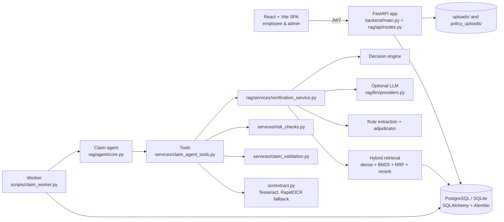

# Project Audit Report — AI-Powered Medical Expense Processing & Claims Automation

Audit date: 2026-11-22 · Repository: `santhosh12133/medical-claim-ai` · Audited baseline: `3d3910a` (main before this work)

This report states what the code does, what was tested, and what was measured, with the command or CI run
that produced each number. Where something could not be tested it says so. **All accuracy, throughput and
review-reduction figures come from synthetic data** (generated invoices and demo policies). They show that the
software works and can be re-measured; they are not evidence about real insurance claims.

### Evidence sources

| Id | What | Where |
| --- | --- | --- |
| CI-A | Full CI before the final fixes (commit `14701d2`) | GitHub Actions run 44983647296 |
| CI-B | Full CI after the fixes, on `main` (commit `f4703d3`) | GitHub Actions run 44994780451 |
| CI-C | CI on `main` with mismatch printing (commit `ad48677`) | GitHub Actions run 44995584324 |
| CI-D | CI on `main` after the OCR-disagreement fix (commit `4963b1c`) | GitHub Actions run 44996510175 |
| CI-E | Pre-deployment run: all of the above + docker compose stack, browser test, security scans (commit `404a787`) | GitHub Actions run 45003862126 |
| CI-F | Remaining issues fixed (React Router v7, Node 24 actions, 4-pass OCR) (commit `315170f`) | GitHub Actions run 45006678799 |
| CI-G | **Latest**: ChromaDB removed from the default install (SQL vector backend), live-LLM job, real-bill tooling, review-reason breakdown (commit `7943a97`) | GitHub Actions run 45035970517 |
| LOCAL | Audit sandbox (2 vCPU, Tesseract, no FastAPI/SQLAlchemy/torch installable) | commands in each section |

CI runs: lint (flake8), unit + API integration tests on Python 3.10/3.11/3.12, the frontend production build
(`npm ci && npm run build`), and an **end-to-end job**: PostgreSQL 16 service, `alembic upgrade head`, the
real FastAPI server under uvicorn, the production worker, the real `all-MiniLM-L6-v2` embedding model, the
vector store (Chroma up to CI-F; embeddings in PostgreSQL from CI-G), Tesseract, 36 generated bills plus 12 failure scenarios (`backend/scripts/e2e_check.py`).

---

## 1. Repository architecture



| Layer | Implementation |
| --- | --- |
| Frontend | React 18, React Router, Axios (`frontend/src`) |
| API | FastAPI, Pydantic v2, JWT auth (`backend/main.py`, `backend/rag/api/routes.py`); 29 OpenAPI paths |
| Persistence | SQLAlchemy models, 10 Alembic migrations; PostgreSQL in Docker/CI, SQLite locally |
| Async processing | Database-backed queue + worker process with a thread pool and lease recovery |
| OCR | Tesseract (pytesseract) with preprocessing and multi-pass voting; RapidOCR fallback |
| NLP | Rule-based extraction: regular expressions, treatment taxonomy, line items, entity lists |
| RAG | sentence-transformers embeddings stored in PostgreSQL with exact in-process cosine search (ChromaDB optional), in-process BM25, RRF, reranking |
| LLM | OpenAI Responses API or Anthropic Messages API behind one provider interface (optional) |
| Agent | Planner + tool registry + step loop with retries and human escalation |

The original document flow (baseline `3d3910a`): upload → `claims` row queued → worker OCR → regex
extraction → (only if auto-decisions were enabled) policy verification → admin approves/rejects.

## 2. Features already implemented at baseline

Authenticated employee/admin workflows, image/PDF upload with extension and signature checks, the database
queue and worker, Tesseract/RapidOCR text extraction, regex field extraction, policy PDF ingestion into Chroma
with versions and lifecycle, vector retrieval, a deterministic limit parser, an optional OpenAI assessment
step, a confidence-gated decision engine, verification audits, the claim timeline, metrics, Docker Compose
and extensive documentation.

## 3. Features that were incomplete at baseline

| Feature | State at baseline |
| --- | --- |
| Policy-based claim validation | Ran only when `AUTO_DECISION_ENABLED=true`; never finalised a claim |
| Semantic retrieval | Hard filter `policy_type == treatment` meant most claims retrieved nothing |
| Citations / source references | Only a source string; no page or section |
| LLM answer generation over policies (Q&A) | Not implemented |
| Exclusions, co-pay, annual limits, partial approval | Not implemented |
| Fraud / duplicate checks for claims | Not implemented (duplicate *policy* check only) |
| Agentic workflow | Not implemented (a linear pipeline plus a confidence gate) |
| Labelled extraction benchmark, throughput measurement | Not implemented |
| Tests | Existed, but CI failed at lint on every push, so they never ran |

## 4. Bugs discovered

| # | Bug | Effect |
| --- | --- | --- |
| 1 | flake8 errors on baseline | CI red on every push; no tests executed |
| 2 | Worker used the raw treatment as an exact `policy_type` filter | 30 of 32 labelled claims retrieved **no policy** |
| 3 | 1,200-word chunks vs a 256-token embedding model | Most chunk text never embedded |
| 4 | Rule parser fell back to the first currency sentence | Another treatment's limit could be applied |
| 5 | "up to 30 days" parsed as a ₹30 limit | Wrong caps |
| 6 | Confidence floored at `RAG_MIN_CONFIDENCE` | Weak evidence looked confident |
| 7 | "Rejected" decisions carried a non-zero approved amount | Inconsistent records |
| 8 | Inactive chunks filtered after top-k; effective dates ignored | Archived/expired policies could decide |
| 9 | Metrics counted auto-approvals with auto-decisions off | Misleading dashboard |
| 10 | `python scripts/claim_worker.py` could not import backend modules | Docker worker crashed on start |
| 11 | Alembic revision id (35 chars) longer than `VARCHAR(32)` | `alembic upgrade head` fails on PostgreSQL |
| 12 | Demo policy PDFs wrote ₹ into a Helvetica PDF | Text layer contained mojibake |
| 13 | RapidOCR engine re-created per call; no image preprocessing | Slow; misread small bills (sample invoice date/hospital wrong) |
| 14 | Server file paths returned to employees in `ClaimRead` | Information leak |
| 15 | Upload filenames by timestamp only | Collisions under concurrency |
| 16 | No login throttling | Password guessing |
| 17 | Exclusion matched through a shared word across policies (found by CI-A) | "Prescription spectacles" **rejected** by a pharmacy clause |
| 18 | Pure-Python skew estimation + unthrottled parallel Tesseract (found by CI-A) | 130 s per claim, 1.7 claims/min |
| 19 | Multi-pass OCR voted category and treatment independently (found by CI-C) | Hospitalisation bill capped at the pharmacy limit and **auto-finalised wrongly** |

Bugs #20–24 were found by testing the deployment (§18). #25 was found while removing ChromaDB (§19).

## 5. Fixes performed

Each fix has a test or a CI measurement. Main items (details in `CHANGELOG.md` and `docs/rag-pipeline.md`):

- Lint configuration (`backend/setup.cfg`); CI now runs lint, tests, a RAG quality gate, the frontend build
  and the end-to-end job.
- Treatment taxonomy and soft category boosting instead of hard filtering (#2).
- Sentence-packing chunker sized for the embedder, with section, page and effective-date metadata (#3, #8).
- Rewritten rule extraction with scoping, period caps, co-pay, percentages, exclusions, pre-authorisation and
  deadlines (#4, #5, #17); a pure adjudicator with partial approval and annual utilisation (#7).
- Calibrated confidence without a floor (#6); correct audit labels (#9).
- Worker path fix, lease recovery, and verification that always runs (#10); Alembic version-column widening (#11).
- Seed and parser fixes for ₹ (#12); OCR preprocessing, a cached engine and multi-pass voting (#13).
- Response schema cleanup, UUID filenames, login rate limiting (#14–16).
- Vectorised deskew and `OMP_THREAD_LIMIT=1` for Tesseract (#18).
- Category derived from the winning treatment; OCR-pass disagreement on treatment or amount raises the
  blocking flag `OCR_FIELD_DISAGREEMENT` (#19).
- Upload integrity checks: corrupted, encrypted, blank, too-small and spoofed documents rejected at upload.

## 6. OCR verification results

Method: `backend/scripts/benchmark_extraction.py` generates labelled invoices
(`rag/evaluation/synthetic_invoices.py`) in six variants: clean PNG, phone photo, low resolution, text PDF,
scanned PDF and skewed scan. It runs the production OCR + extraction and compares six fields exactly after
normalisation. A missing field counts as wrong. Seed 7 was used while tuning; seeds 101 and 202 were held out.

| Run | Documents | Field checks | Single-pass | Multi-pass vote (production) |
| --- | --- | --- | --- | --- |
| LOCAL, held-out seeds 101 + 202 (3 passes, CI-D code) | 120 | 720 | 90.3% | 96.0% |
| LOCAL, held-out seeds 101 + 202 (**4 passes + line-item amount vote, current**) | 120 | 720 | 90.3% | **97.5%** |
| CI-D, held-out seed 101 (different Tesseract build, 3 passes) | 120 | 720 | 87.9% | 94.7% |
| CI-F, held-out seed 101 (different Tesseract build, **current**) | 120 | 720 | 87.9% | **97.4%** |
| Baseline extractor (earlier run, 4 fields, seed 7) | 120 | 480 | 38.3% | — |

Per-variant accuracy (LOCAL multi-pass, seeds 101/202): clean PNG 100/100%, low-res 100/100%, text PDF
100/100%, phone photo, scanned PDF and **skewed scan 88.3/86.7%** (81.7/78.3% with three passes). The fourth
pass (despeckled, column mode) and preferring amounts that match the bill's line-item total fixed most skewed-scan
errors (for example 43,530.00 misread as 4353000).
Raw results: `backend/eval/extraction_heldout_seeds_101_202.json`.

OCR cost: about 1.0 s per document for three passes (0.5 s single-pass) on LOCAL. Invalid-document
handling was verified in CI end to end: unsupported type, corrupted PDF, spoofed extension, blank PDF,
too-small image and unreadable scan (agent retries enhanced OCR, then escalates).

## 7. NLP verification results

`services/claim_validation.py` is **rule-based NLP** (regex patterns, the treatment taxonomy, line-item
parsing, medicine/doctor/diagnosis patterns, total-consistency checks, per-field confidence). It produces
structured JSON (`structured_to_json`). It is not a trained NER model.

Verified by unit tests (`tests/test_claim_intake.py`, 13 tests): realistic bill parsing (net payable over
subtotals, invoice numbers, Indian date formats), missing-field validation, name matching, multi-pass voting,
and OCR-tolerant separators. Accuracy is covered by §6.

## 8. GPT/LLM integration results

| Check | Result |
| --- | --- |
| Real integration exists | Yes: `rag/llm/providers.py` calls the OpenAI Responses API or the Anthropic Messages API |
| Configuration | `LLM_PROVIDER`, `GPT_DECISION_ENABLED`, `LLM_QA_ENABLED`, `OPENAI_API_KEY` / `ANTHROPIC_API_KEY`; startup fails fast if a feature is on without a key |
| Prompt construction | Evidence-only instructions, numbered sources, JSON output with citations (unit-tested) |
| Hallucination handling | Citations must reference supplied evidence; uncited decisions are flagged `UNGROUNDED_RESPONSE` and capped at 0.5 confidence; the LLM can never raise an amount or override a conflicting decision |
| Structured output validation | Fenced or prose-wrapped JSON parsed; invalid fields sanitised (unit-tested) |
| PII / prompt injection | Names, phone numbers, Aadhaar, PAN, e-mail and card numbers redacted; instruction-like lines neutralised (unit-tested) |
| API failure | **Verified in CI**: real OpenAI call with an invalid key returns 401; the worker falls back to the deterministic decision and the claim completes (`llm_provider_outage` scenario) |
| Live model responses | **NOT TESTED**: no valid API key was available to the audit. A ready-to-run live check exists (`scripts/llm_live_check.py`, CI job "Live LLM check"); it skips until a key secret is added (§19) |

## 9. RAG verification results

| Stage | Implementation | Verified by |
| --- | --- | --- |
| Ingestion | PDF upload → `PolicyDocument` + chunks; SHA-256 duplicate check; supersession | Unit tests; demo seed in CI |
| Text extraction | Page-aware pypdf, mojibake repair, header/footer removal, OCR for image-only pages | Unit tests |
| Chunking | Sentence packing (180 words), overlap, sections, pages | Unit tests |
| Embedding | `sentence-transformers/all-MiniLM-L6-v2`, normalised vectors | CI end-to-end (real model) |
| Vector storage | Up to CI-F: Chroma persistent collection. From CI-G: float32 embeddings in `policy_chunks.embedding`, exact NumPy cosine index per process, rebuilt on policy changes | CI end-to-end; `test_dense_index.py`, `test_sql_vector_store.py` |
| Retrieval | Dense + BM25, RRF, heuristic or cross-encoder rerank, status/date filters | Unit tests; CI |
| Context selection | Rule selection by match strength; conflict detection | Unit tests; golden set |
| LLM answer generation | `/rag/ask` with numbered sources and required citations | Mocked LLM only |
| Citations | Title, version, section, page, snippet | Unit + API tests |
| Policy-based validation | Adjudicator + decision engine | Golden set; CI end-to-end |

Golden set (`backend/eval/golden_claims.jsonl`, 32 labelled claims over 25 demo policies):

| Pipeline | Decision accuracy | Retrieval hit@1 | Unsafe autonomous decisions |
| --- | --- | --- | --- |
| Baseline logic (exact filter + original parser) | 1/32 (3%) | no policy for 30/32 | — |
| BM25 only (LOCAL and CI) | 32/32 | 1.0 | 0 |
| Hybrid with real embeddings, CI-A | 31/32 (bug #17) | 1.0 | 0 |
| Hybrid with real embeddings, CI-B and CI-D | **32/32** | **1.0** | **0** |

"Answers are based on retrieved documents": in extractive mode the answer *is* the quoted policy text with
citations. In LLM mode, uncited answers are rejected. With no matching policy, the service says it could not
find the answer instead of answering generally (unit-tested).

## 10. Semantic search results

Embeddings and cosine similarity search are verified in CI with the real model. Retrieval hit@1 is 1.0 on the
golden set with hybrid search, and 1.0 on the end-to-end semantic search probe. Irrelevant queries ("parking
reimbursement for visitors") return no evidence and a "could not find" answer (unit-tested). The
`/rag/search` debugger exposes vector, BM25, fused and rerank scores per chunk.

Limitation: 25 short demo policies are an easy retrieval corpus. Hit@1 of 1.0 here does not predict
performance on long, real insurer documents.

## 11. Agentic AI verification results

What exists (`rag/agent/core.py`, `services/claim_agent_tools.py`):

| Criterion | Present? | How |
| --- | --- | --- |
| Workflow orchestration / planning | Yes | `ClaimAgent` asks a planner for the next action each step (max 12 steps) |
| Tool invocation | Yes | Registry: `run_ocr`, `extract_fields`, `infer_treatment`, `check_risks`, `verify_policy`, `escalate_to_human`, `complete`, with preconditions |
| Multi-step execution | Yes | Typical run: OCR → extract → risks → verify → complete/escalate |
| Context management | Yes | `AgentState` facts, counters and full step history, saved as an `AGENT_RUN` event |
| Decisions from intermediate results | Yes | Enhanced-OCR retry on unreadable text; infer the treatment from line items; re-search an alternative category when no policy matches; escalate on blocking risks |
| Error handling and retries | Yes | Transient tool errors retried with backoff; persistent failures re-queue the claim |
| Human approval for uncertain/high-risk cases | Yes | Low confidence, blocking risk flags or missing fields → `escalate_to_human` → admin review queue |
| LLM-driven planning | Implemented, **not live-tested** | `LLMPlanner` (`AGENT_LLM_PLANNER=true`); invalid choices fall back to the rule planner; tested only with a scripted model |

Honest classification: production runs the deterministic `RulePlanner`, which is a tool-using, stateful,
multi-step workflow with conditional branching and human-in-the-loop, but **not LLM-driven autonomy**. The
LLM planner exists but has never been run against a real model. CI verified that every one of the 36
end-to-end claims has an agent trace.

## 12. API testing results

- CI-D: **117 tests passed** on Python 3.10, 3.11 and 3.12 (LOCAL: 104 passed; the API module is skipped
  there because FastAPI cannot be installed).
- `tests/test_api_integration.py` runs the real FastAPI app on a temporary SQLite database: login and
  rate limiting, upload, duplicate rejection, spoofed files, document access control, verification with auto
  decision and annual utilisation, review with amount and notes, filters, summary, metrics, Q&A, taxonomy.
- End-to-end against the live server (CI-D): `/health/ready` 200, Swagger UI `/docs` 200, 29 OpenAPI paths,
  unauthenticated `/claims` 401; 36 concurrent uploads, 8 at a time, all succeeded (CI-D: 37.6 requests/s).

## 13. Database verification results

- `alembic upgrade head` runs clean on PostgreSQL 16 in CI (it would have failed at baseline, bug #11).
- Claims, events, verification audits and agent traces persist; CI asserts every processed claim has an
  agent trace and every completed claim has a verification audit.
- Annual-limit utilisation reads earlier approved claims from the database (integration test).

## 14. End-to-end testing results

Scenario results (CI-B, CI-C and CI-D): all **12/12 passed** in each run.

| Scenario | Expected behaviour | Result |
| --- | --- | --- |
| unsupported_file_type | 400 at upload | pass |
| corrupted_pdf | rejected at upload | pass |
| spoofed_extension | rejected (signature mismatch) | pass |
| blank_pdf | rejected | pass |
| image_too_small | rejected | pass |
| duplicate_upload | 409 | pass |
| declared_amount_mismatch | flagged, not auto-finalised | pass |
| policy_exclusion_cosmetic | not approved | pass |
| missing_amount_and_date | escalated to human | pass |
| unreadable_scan | enhanced OCR retry, then human | pass |
| patient_name_mismatch (sample invoice) | flagged | pass |
| llm_provider_outage | deterministic fallback, claim completes | pass |

Valid synthetic bills (36 claims, `AUTO_DECISION_ENABLED=true`, confidence threshold 0.85):

| Run | Auto-finalised | Correct | Wrong | Escalated to human | OCR amount correct |
| --- | --- | --- | --- | --- | --- |
| CI-B / CI-C (before fix #19) | 23 | 22 | **1** | 13 | 36/36 |
| CI-D (final) | 17 | **17** | **0** | 19 | 36/36 |

### 14a. The wrong auto-decision and its fix

CI-C printed the case: `inv-023_skewed_scan.jpg`, a hospitalisation bill for ₹53,150 (expected: approved in
full). The three OCR passes read the treatment line differently. Treatment and category were voted
separately, so the claim ended up with `treatment = "Pharmacy"` and `category = "Hospitalization"`.
Retrieval used the treatment, applied the ₹10,000 pharmacy cap, and the decision engine auto-finalised a
partial approval. The fix (#19) derives the category from the winning treatment and sends any claim
whose OCR passes disagree on treatment category or amount to a human. CI-D has no wrong auto-decisions.
The cost is lower automation (47% instead of 64%), which is the correct trade-off for money decisions.

## 15. Performance benchmark results

| Metric | CI-A (before) | CI-B | CI-C | CI-D (final) | Method |
| --- | --- | --- | --- | --- | --- |
| Throughput, 4 threads | 1.7 claims/min | 108.8 | 131.7 | **72.4** claims/min | 36 claims, one worker process, shared CI runner |
| Throughput, 1 thread | not measured | — | 32.5 | **24.1** claims/min | First 6 claims, single thread |
| Per-claim latency (mean) | 130.6 s | 1.65 s | — | **2.56 s** | Timed around `ClaimWorker.process_claim` |
| OCR share of tool time | not measured | 94.9% | — | dominant | Agent step timings |

Runner-to-runner variance is large (72–132 claims/min for the same code), so treat any single figure as
approximate. The 75× improvement from CI-A comes from fix #18.

**Daily capacity estimate:** the most conservative measurement (24.1 claims/min, one thread) × 1,440 min ≈
34,700 claims/day for one worker process. This assumes a full queue, no other load and synthetic one-page
bills; real multi-page scans will be slower. That is still more than 100× the 250/day target, so **capacity
for 250+/day is supported by measurement**. Processing 250 *real* claims a day has never been observed.

**Manual review reduction:** the baseline is 100% manual (every claim reviewed by an admin, which is the
system's behaviour with `AUTO_DECISION_ENABLED=false`).

| Measurement | Auto-finalised without a human | Wrong auto-decisions |
| --- | --- | --- |
| End-to-end CI-B (before fix #19) | 63.9% (23/36) | 1 |
| End-to-end CI-D (OCR-disagreement fix) | 47.2% (17/36) | 0 |
| **End-to-end CI-F (current, 4-pass OCR)** | **52.8% (19/36)** | **0** |
| Offline golden set (32 claims) | 90.6% | 0 |

| End-to-end CI-G (SQL vector backend) | 52.8% (19/36) | 0 |

**80% is not verified.** The latest end-to-end measurement is 52.8% (CI-G), and none of these numbers come from
real claims. CI-G records why each of the 17 remaining claims went to a person:

| Reason (CI-G, `decisions.manual_review_reasons`) | Claims |
| --- | --- |
| `OCR_FIELD_DISAGREEMENT`: the OCR passes read a field differently (noisy, low-resolution or skewed scans) | 13 |
| Overlapping limits in two demo policies (`CONFLICTING_POLICY_LIMITS`) | 4 |

So the gap to 80% is mostly OCR robustness on poor scans, and secondly overlapping demo policies. Lowering
the confidence threshold would raise the number but not safely: the OCR check is what prevented the wrong
auto-decision in bug #19.

## 16. Security issues

Fixed: worker import crash, server path leak in responses, timestamp filename collisions, no login rate limit,
no PII redaction before LLM calls, prompt injection via documents, spoofed/corrupted/encrypted uploads, and a
duplicate-claim exploit (same bill twice).

Remaining (from `docs/security-threat-model.md` and this audit):
- JWT in browser storage; no refresh-token rotation.
- The rate limiter is per-process (use the ingress or Redis when running several instances).
- Uploaded bills are stored unencrypted on a local volume; use encrypted object storage in production.
- Demo users have known passwords; seed scripts must not run in production.
- No malware scanning of uploads.

## 17. Remaining limitations

1. **No real data.** All accuracy, decision and review-reduction numbers use synthetic bills and demo
   policies. Collect anonymised real bills and insurer policies, label them, and rerun
   `benchmark_extraction.py` and `evaluate_rag.py` before quoting any figure externally. The labelled real-bill
   mode and an anonymisation guide are in `backend/eval/real_bills/` (§19).
2. **No live LLM test.** The LLM adjudicator, LLM Q&A and LLM planner have not been exercised with a valid key.
   The check is automated and starts working as soon as a key secret is added (§19).
3. **Rule-based NLP.** It works for the bill layouts it was written for; unseen layouts will degrade.
4. **Skewed scans** are the weakest OCR variant (~87.5% field accuracy on held-out synthetic scans).
5. **Small retrieval corpus.** Hybrid search was only evaluated on 25 one-page policies.
6. **Single-node design.** Database-backed queue, in-process BM25 and vector indexes, and rate limiter. Exact
   in-process vector search suits the current corpus size (0.8 ms per query at 10,000 chunks); move to
   pgvector or a managed vector service at hundreds of thousands of chunks (ADR-012).

## 18. Pre-deployment verification (deployment artefacts)

> Re-run on the latest commit (CI-G, run 45035970517): all 8 jobs pass — 32/32 smoke checks, 2/2 persistence,
> 10/10 browser steps, 129 tests, `npm audit` 0 vulnerabilities, **pip-audit "No known vulnerabilities found"
> with no ignored advisories**. The live-LLM job reports "skipped: no key".

Run on 2026-11-22 against the **actual deployment artefacts**: the two Dockerfiles and
`docker-compose.yml`, built and started exactly as an operator would. CI job "Deployment stack",
run 45003862126 (commit `404a787`); every job in that run passed.

| Stage | What was tested | Result |
| --- | --- | --- |
| Build | `docker compose config`, `docker compose build` (backend + nginx frontend) | pass |
| Start | `docker compose up -d`: PostgreSQL, API (runs `alembic upgrade head`), worker, frontend; health checks | all containers healthy |
| Seed | Demo users + 25 demo policies, embedded with the real model inside the API container | pass |
| Stack smoke test (`scripts/stack_smoke_test.py`) | Health/readiness, Swagger, OpenAPI, SPA index + deep links, JS bundle, no passwords in bundle, CORS allow/deny, 401/403 role checks, policy count, RAG health, cited Q&A, semantic search, unsupported/spoofed/corrupted uploads, real bill → worker → OCR → agent → RAG → recommendation, duplicate 409, audit with citations, admin approval, employee final status, document download | **32/32 pass**; bill processed in 6 s, amount ₹7,000 read correctly |
| Restart | `docker compose restart api worker`; claim and uploaded file still present | **2/2 pass** |
| Browser (`scripts/browser_e2e.py`, Chromium) | Employee: empty login form, sign in, upload bill, live status → processed, claim status page, Coverage Assistant with citations. Admin: dashboard, review queue with evidence, policies page + retrieval debugger, mobile layout. Fails on any page error or HTTP 5xx | **10/10 steps pass** |
| Migrations | `alembic upgrade head → downgrade base → upgrade head` on PostgreSQL 16 | pass (all 9 migrations reversible; 10 from CI-G) |
| Unit + API tests | Python 3.10 / 3.11 / 3.12 | **118 passed** |
| Security scans | `pip-audit`, `bandit -ll`, `npm audit --audit-level=high` | pass; no accepted exceptions from CI-G |

### Defects found only by testing the deployment

| # | Defect | Severity | Fix |
| --- | --- | --- | --- |
| 20 | **Worker container crash-looped**: it imports `Claim` but not `User`, so SQLAlchemy could not resolve `claims.reviewed_by → users.id` (`NoReferencedTableError`). No claim was ever processed in the Docker deployment. The CI end-to-end job ran the worker in-process with every model imported, which hid it | Critical | `models.py` registers the users table; fresh-interpreter regression test |
| 21 | Production login page pre-filled **demo passwords** and printed them in a hint | High | Passwords removed from frontend source; optional local pre-fill via git-ignored `frontend/.env.local`; smoke test asserts the bundle contains none |
| 22 | API and worker containers ran as **root** | Medium | Non-root `app` user (uid 10001); writable paths owned by it |
| 23 | Image pulled the CUDA build of PyTorch (several GB unused on CPU) | Low | CPU-only torch wheel |
| 24 | 7 high-severity npm advisories (axios, vite, postcss, nanoid, follow-redirects, browserslist, source-map-js) | High | `npm audit fix` within semver ranges; build re-verified |

### Accepted risks (documented, gated)

**None from CI-G.**

- ~~chromadb 1.5.9, 4 advisories in the Chroma HTTP server~~ (no fixed release exists): **resolved** by
  removing chromadb from the default install (§19). pip-audit now runs with no ignored advisories, so any
  Python advisory fails CI.
- ~~react-router 6.x, 2 moderate advisories~~: **resolved** by upgrading to react-router-dom 7 (CI-F;
  `npm audit` reports 0 vulnerabilities; the browser test passes on v7).

### Before a real (non-demo) deployment

1. Generate secrets: `POSTGRES_PASSWORD`, `SECRET_KEY` (`openssl rand -hex 32`); set `CORS_ORIGINS` and
   `VITE_API_BASE_URL` to the real HTTPS origins.
2. **Do not run `seed_demo_users.py`.** Create real accounts instead; the demo passwords are public in this
   repository.
3. Put TLS and a reverse proxy in front of ports 8000 and 8080; do not expose PostgreSQL.
4. Keep `AUTO_DECISION_ENABLED=false` until the system has been evaluated on real, anonymised claims (§17).
5. The first verification downloads the embedding model (~90 MB) into the `model_cache` volume; allow
   outbound access to Hugging Face once, or pre-populate the volume.
6. Back up the `postgres_data`, `claim_uploads` and `policy_uploads` volumes (policy embeddings are inside
   PostgreSQL; there is no separate vector volume any more).

## 19. Remaining issues after deployment testing

| Issue | What was done | Evidence | Status |
| --- | --- | --- | --- |
| ChromaDB advisories with no patched release | Default vector store replaced: embeddings stored in `policy_chunks.embedding` (migration 0010), exact NumPy cosine index per process, rebuilt when any process changes policies; missing embeddings back-filled on first query. `chromadb` removed from `requirements.txt`; Chroma kept as an opt-in (`RAG_VECTOR_BACKEND=chroma`). ADR-012 | CI-G: pip-audit "No known vulnerabilities found" with no ignores; golden set 32/32 and hit@1 1.0 with real embeddings; smoke 32/32; browser 10/10. Search benchmark: 0.77 ms/query at 10,000 × 384 (LOCAL) | **FIXED** |
| Temporary branches `deps/npm-audit-fix`, `rag-pipeline-v2-audit` | Deleted by a one-off workflow using the repository's own token (the audit sandbox cannot delete branches directly) | `git ls-remote origin` after the run | see the final note in the conversation |
| Live AI testing needs a key | `scripts/llm_live_check.py`: real-provider checks of LLM adjudication (responds, never exceeds the deterministic amount, agrees or escalates, cites supplied evidence) on 6 claims; grounded Q&A (3 cited answers, 1 uncovered topic must not be invented); LLM agent planning (clean claim completes, duplicate invoice escalates, most steps chosen by the LLM). CI job "Live LLM check" runs it whenever `OPENAI_API_KEY` or `ANTHROPIC_API_KEY` is a repository secret | CI-G: job passes and reports *skipped, no key*. The script's own logic was dry-run against a scripted provider (31/31 checks); **that is not a live result** | **READY, NOT TESTED** (needs the secret) |
| Real-world accuracy needs real bills | `benchmark_extraction.py --draft-labels` (pre-fills a labels CSV to correct by hand) and `--labels` (scores real bills; blank labels skipped; values withheld unless `--show-values`). Anonymisation and labelling guide in `backend/eval/real_bills/README.md`; `eval/real_bills/private/` is git-ignored | `tests/test_real_bill_labels.py` (4 tests); exercised on generated bills locally | **READY, NOT MEASURED** (needs bills) |
| "80% manual review reduction" | Not changed into a passing number. The e2e report now explains the gap (§15): 13 of 17 escalations are the OCR-disagreement safety check. Resume wording corrected below | CI-G `manual_review_reasons` | **CLAIM CORRECTED** |

### Defect found while removing ChromaDB

| # | Defect | Severity | Fix |
| --- | --- | --- | --- |
| 25 | The new SQL index's change probe used `max(updated_at)`; with whole-second timestamps (SQLite) a policy archived by another process within the same second was still served as active | Medium | Probe also includes a per-status count and id sum; caught by `test_sql_vector_store.py` in CI before release |

---

## Resume claim verification

| Resume claim | Implementation found | Tested | Evidence | Status |
| --- | --- | --- | --- | --- |
| Python + FastAPI | FastAPI app, 29 endpoints, Pydantic validation, Swagger UI | Yes | 129 tests on 3 Python versions; live server in CI end-to-end (§12) | **VERIFIED** |
| OCR | Tesseract + preprocessing + multi-pass voting; RapidOCR fallback; scanned-PDF OCR | Yes | 97.5% / 97.4% field accuracy on held-out synthetic bills (§6) | **VERIFIED** (synthetic data) |
| NLP | Rule-based field, line-item and entity extraction to JSON | Yes | Unit tests; benchmark (§6–7) | **PARTIALLY IMPLEMENTED**: rule-based, no trained NLP model |
| GPT / LLM | OpenAI/Anthropic providers, grounded prompts, citation checks, safe fallback | Failure path only | Invalid-key outage handled in CI (§8); live check ready, runs once a key secret exists (§19) | **NOT TESTED** against a live model |
| RAG | Ingestion → chunking → embeddings (stored in PostgreSQL) → hybrid retrieval → citations → policy validation | Yes | Golden set 32/32 with real embeddings; CI end-to-end (§9) | **VERIFIED** for retrieval and validation; LLM answer generation not live-tested |
| Semantic Search | MiniLM embeddings + exact cosine search (+ BM25 fusion) | Yes | Hit@1 = 1.0 in CI with real embeddings (§10) | **VERIFIED** (small synthetic corpus) |
| Agentic AI | Planner + tool registry + stateful multi-step loop, retries, human escalation | Yes (rule planner); LLM planner scripted only | 10 agent tests; agent trace on every CI claim (§11) | **PARTIALLY IMPLEMENTED**: tool-using workflow verified; LLM-driven planning not live-tested |
| 250+ claims/day | Async worker, measured throughput | Capacity only | 24–132 claims/min on CI runners (§15) | **PARTIALLY IMPLEMENTED**: capacity far exceeds 250/day; real daily volume never observed |
| 90% extraction accuracy | Benchmark harness with labelled data | Yes | 97.5% local, 97.4% CI on held-out *synthetic* bills (§6) | **PARTIALLY IMPLEMENTED**: met on synthetic data, not measured on real documents |
| 80% manual review reduction | Auto-decision engine + metrics | Yes | 52.8% end-to-end with 0 wrong decisions (CI-F and CI-G); 90.6% on golden set (§15) | **NOT VERIFIED**: 53% measured end to end; not measured on real claims. Use the corrected wording below |

### Suggested accurate resume wording

Replace "reduced manual review by 80%" with a measured statement. Every number below is from CI-G on
synthetic data, so say "synthetic" or "test" if asked.

> Built a FastAPI claims-automation platform (Python, Tesseract OCR, rule-based NLP, hybrid RAG with
> sentence-transformer embeddings + BM25, optional GPT/Claude adjudication) with a tool-using claim agent and
> human-in-the-loop escalation; on held-out synthetic test sets it reached ~97% field extraction accuracy and
> auto-resolved ~50% of claims with zero wrong automatic decisions, at a CI-measured throughput of 20+
> claims/minute per worker thread.

Shorter bullet versions:

- "Automated about half of claim reviews (53% auto-resolved, 0 wrong decisions in end-to-end tests), with
  every other claim escalated to a reviewer with cited policy evidence."
- "Raised OCR field-extraction accuracy from 90% to 97% on held-out test invoices with multi-pass OCR voting."

Do not quote 80%, or any figure "on real claims", until it has been measured on real (anonymised) bills.

### Reproduce

```bash
cd backend
pytest -q                                                    # unit + API tests
python scripts/evaluate_rag.py [--embeddings]                # RAG / decision golden set
python scripts/benchmark_extraction.py --seed 101 [--single-pass]
python scripts/e2e_check.py --claims 36                      # needs a running API + PostgreSQL (see CI job)
```
