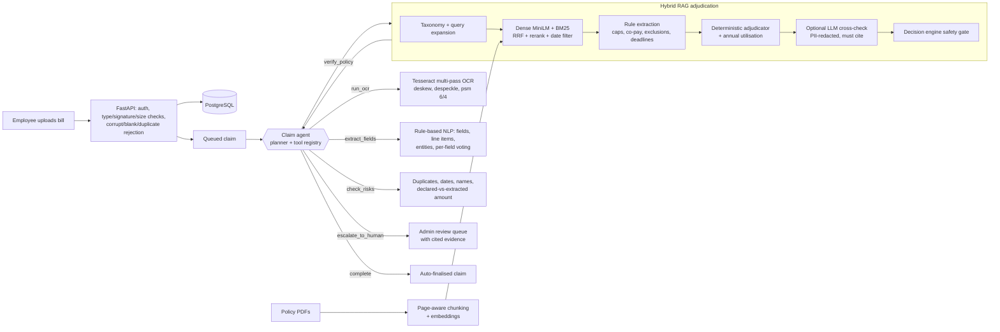

# Medical Claim AI

> **AI-assisted medical reimbursement processing with asynchronous document intelligence, policy-grounded verification, guarded autonomous decisioning, and human-review controls.**

[](https://github.com/santhosh12133/medical-claim-ai/actions)


Medical Claim AI is a production-oriented full-stack application that turns medical reimbursement documents into structured, policy-aware claim decisions. It deliberately separates OCR, deterministic validation, retrieval-augmented policy verification, optional GPT assessment, and final decision safety gates so that model uncertainty can become **human review** instead of an unsafe automated outcome.

---

## Contents

- [Why this project](#why-this-project)
- [Platform at a glance](#platform-at-a-glance)
- [Verification status (measured)](#verification-status-measured)
- [Core workflow](#core-workflow)
- [Architecture](#architecture)
- [Decision safety model](#decision-safety-model)
- [Key capabilities](#key-capabilities)
- [Technology stack](#technology-stack)
- [Repository structure](#repository-structure)
- [Documentation](#documentation)
- [Local development](#local-development)
- [Deploy to a server (free option)](#deploy-to-a-server-free-option)
- [Docker deployment](#docker-deployment)
- [API overview](#api-overview)
- [Testing and evaluation](#testing-and-evaluation)
- [Security](#security)
- [Observability and operations](#observability-and-operations)
- [Performance claims policy](#performance-claims-policy)
- [Production readiness](#production-readiness)
- [Project status](#project-status)
- [Engineering principles](#engineering-principles)

---

## Why this project

Medical reimbursement processing combines messy documents with business rules that need to be traceable. A useful automation system therefore needs more than OCR or a generative model.

This project treats the workflow as a layered system:

1. **Extract** information from the document.
2. **Validate** critical claim fields deterministically.
3. **Retrieve** relevant policy evidence.
4. **Interpret** explicit reimbursement rules deterministically.
5. **Assess** with GPT only when enabled and only from supplied evidence.
6. **Gate** the final decision using confidence, amount, conflict and human-review controls.
7. **Audit** the outcome so an operator can understand what happened.

The result is intended to be explainable, testable and deployable rather than an opaque "AI approved it" workflow.

---

## Platform at a glance

```text
                    MEDICAL CLAIM AI

Employee Browser
      |
      | secure claim upload
      v
+-------------------+          +-------------------+
| React + Vite      |          | Admin UI          |
| Employee Workflow |          | Review / Policies |
+---------+---------+          +---------+---------+
          |                              |
          +---------------+--------------+
                          |
                          v
                +-------------------+
                | FastAPI API       |
                | Auth / Claims /   |
                | RAG / Admin       |
                +---------+---------+
                          |
            +-------------+-------------+
            |                           |
            v                           v
      +-----------+              +--------------+
      | PostgreSQL|              | Claim Worker |
      | source of |              | OCR / RAG /  |
      | truth     |              | verification |
      +-----------+              +------+-------+
                                         |
                              +----------+----------+
                              |                     |
                              v                     v
                         +------------+       +-----------+
                         | Embeddings |       | Optional  |
                         | (Postgres) |       | LLM       |
                         +------------+       +-----------+
```

---

## Verification status (measured)

Every number below comes from a command you can rerun; the full audit with methodology, evidence and
the resume-claim table is in [`PROJECT_AUDIT_REPORT.md`](PROJECT_AUDIT_REPORT.md).



| Area | Result | Evidence |
| --- | --- | --- |
| Field extraction (OCR + NLP) | **97.5%** field accuracy on 120 held-out synthetic invoices (720 field checks); 90.3% with single-pass OCR | `python scripts/benchmark_extraction.py --seed 101` / `--seed 202`; `backend/eval/extraction_heldout_seeds_101_202.json` |
| Policy retrieval | hit-rate@1 = 1.0 on 32 labelled claims (BM25-only and hybrid) | `python scripts/evaluate_rag.py [--embeddings]` |
| Policy decisions | 32/32 correct offline; original pipeline 1/32 (no policy retrieved for 30) | `python scripts/evaluate_rag.py`; [`docs/rag-pipeline.md`](docs/rag-pipeline.md) |
| End-to-end | PostgreSQL + API + worker + real embeddings: 12/12 failure scenarios pass; 19/36 synthetic claims auto-finalised, 0 wrong; 20–132 claims/min | CI job "End-to-end"; `scripts/e2e_check.py` |

| Deployment stack | `docker compose` build + up, 32/32 smoke checks, restart persistence, 10/10 Chromium browser steps, full migration rollback, security scans | CI job "Deployment stack"; `scripts/stack_smoke_test.py`, `scripts/browser_e2e.py`; [audit §18](PROJECT_AUDIT_REPORT.md) |

All datasets are **synthetic** (generated invoices, demo policies). They are regression guards, not proof of
real-world accuracy, throughput or review reduction. See the audit report for what is and is not verified.

### Try it with sample documents

```bash
cd backend
alembic upgrade head
python scripts/seed_demo_users.py          # employee@demo.com / admin@demo.com (demo passwords in the script)
python -m scripts.seed_demo_policies        # 25 demo reimbursement policies + embeddings into PostgreSQL
python scripts/benchmark_extraction.py --count 12 --keep ../sample_bills   # writes labelled sample bills
```

Upload any file from `sample_bills/` (or `backend/sample_invoice.png`) as the employee, then open the admin
**Review Queue** to see extracted fields, the agent trace, cited policy evidence and the recommendation. Ask
coverage questions on the **Coverage Assistant** page.

### Known limitations

- Extraction and decision datasets are synthetic; no real (anonymised) bills or insurer policies were evaluated. The tooling for it is ready: see [`backend/eval/real_bills/README.md`](backend/eval/real_bills/README.md).
- Field extraction is rule-based NLP (regular expressions + taxonomy), not a trained NER model; skewed scans remain the weakest variant (~87.5%).
- The LLM integration (OpenAI/Anthropic) has been verified only for graceful failure so far. A live check (`scripts/llm_live_check.py`, CI job "Live LLM check") runs automatically once an `OPENAI_API_KEY` or `ANTHROPIC_API_KEY` repository secret exists; until then, LLM answers, planning and adjudication are untested against a live model.
- The production agent uses the deterministic `RulePlanner`; the `LLMPlanner` is implemented and unit-tested with a scripted model only.
- Throughput was measured on a shared CI runner; real capacity depends on hardware, document mix and worker count.
- Manual-review reduction depends on `AUTO_DECISION_ENABLED` and its confidence threshold. On the synthetic CI mix it is about 53% (19/36, none wrong). Of the 17 escalations, 13 are the OCR safety check (the OCR passes disagreed on a field of a noisy or skewed scan) and 4 are overlapping demo-policy limits; `e2e_check.py` reports the breakdown. It has not been measured on real claim traffic.

---

## Core workflow

### Claim intake

```text
Employee
  -> authenticate
  -> upload image/PDF
  -> server validates signature + size
  -> claim persisted as queued
  -> submission event recorded
  -> API returns
```

### Background processing

```text
Worker
  -> claims queued row with database locking
  -> OCR
  -> structured field extraction
  -> deterministic validation
  -> persist processing result
  -> optional policy verification
  -> final decision / human review
  -> audit + claim events
```

### Policy verification

```text
Policy PDF
  -> validate (signature, size, SHA-256 duplicate check)
  -> page-aware text extraction (+ OCR fallback for scanned pages, mojibake repair)
  -> header/footer removal
  -> sentence-packing chunker sized for the embedder (sections + page numbers kept)
  -> contextual chunk headers ("Policy: ... | Section: ...") -> embeddings
  -> PostgreSQL (chunks + float32 embeddings, versions, lifecycle); exact cosine search in-process
  -> optional supersession of older versions

Claim
  -> treatment taxonomy (e.g. "RCT" -> Dental) + query expansion
  -> hybrid retrieval: dense vectors + BM25, reciprocal rank fusion, reranking
  -> effective-date and active-status filtering
  -> structured rule extraction (cap + period, co-pay, %, exclusions, pre-auth, deadlines)
  -> year-to-date utilisation against annual limits
  -> deterministic adjudication (approve / partial / reject / human review)
  -> optional LLM cross-check (OpenAI or Anthropic; PII-redacted, must cite evidence)
  -> guarded decision engine (blocking risk flags, confidence threshold, amount ceiling)
  -> audit record + claim timeline
```

See [`docs/rag-pipeline.md`](docs/rag-pipeline.md) for the full design and the evaluation results.

---

## Architecture

### Service boundaries

| Component | Responsibility | Scaling unit |
|---|---|---|
| Frontend | Employee/admin experience | Static web deployment / CDN |
| API | HTTP, auth, claim intake, admin/RAG APIs | API replica |
| Claim worker | OCR, extraction, validation, verification | Worker replica |
| PostgreSQL | Transactional state and audit | Managed database |
| Vector index | Exact cosine search over embeddings stored in PostgreSQL (optional ChromaDB backend) | In-process, per API/worker replica |
| File storage | Claim and policy documents | Persistent volume / object storage |
| GPT provider | Optional constrained assessment | External API dependency |

### Source of truth

PostgreSQL is authoritative for users, claims, claim events, policy metadata, processing state and verification audits. Policy embeddings are stored next to their chunks, so there is no second datastore to keep in sync; each process builds its in-memory search index from the database and rebuilds it when policies change. Set `RAG_VECTOR_BACKEND=chroma` (and `pip install chromadb`) to use ChromaDB instead.

### Failure isolation

A slow OCR job must not block an HTTP request. A GPT timeout must not erase a claim. Missing policy evidence must not be converted into an invented answer. The architecture intentionally makes these boundaries explicit.

For the detailed architecture, see [`docs/system-architecture.md`](docs/system-architecture.md).

---

## Decision safety model

The most important engineering property is the decision boundary:

```text
                    Retrieved Policy Evidence
                               |
                               v
                       Deterministic Rules
                               |
                               v
                     Deterministic Baseline
                               |
                    +----------+----------+
                    |                     |
             GPT optional          No GPT / unavailable
                    |                     |
                    +----------+----------+
                               |
                               v
                    ClaimDecisionEngine
                               |
              +----------------+----------------+
              |                |                |
              v                v                v
          APPROVED         REJECTED       HUMAN_REVIEW
```

Guardrails include:

- configurable minimum deterministic confidence
- configurable autonomous maximum amount
- optional requirement that GPT be available
- conflict detection
- GPT confidence gate
- approved-amount ceiling
- human-review escalation
- structured risk flags
- persistent verification audit

GPT cannot create unsupported policy facts or increase the deterministic reimbursement ceiling.

See [`docs/ai-decisioning.md`](docs/ai-decisioning.md).

---

## Key capabilities

### Employee

- authenticated claim submission
- image/PDF upload
- asynchronous processing status
- claim history
- policy decision summary
- live processing status after upload (extracted fields + policy check)
- **Coverage Assistant**: ask "is a ₹30,000 MRI covered?" and get a cited answer plus a coverage estimate

### Administrator

- claim search and review
- manual approval/rejection
- policy ingestion and lifecycle management
- verification audit history
- decision and processing metrics
- claim activity timeline
- review queue with cited evidence, confidence breakdown, extracted rule and risk flags
- approve with an adjusted amount and reviewer notes; reprocess; view the original bill
- policy knowledge-base page: upload, activate/archive, re-index, delete
- retrieval debugger showing vector, BM25, RRF and rerank scores per chunk

### Intelligence and automation

- multi-engine OCR stack with image pre-processing
- deterministic field validation (net payable, invoice number, patient name, multiple date formats)
- hybrid retrieval (dense + BM25 + reciprocal rank fusion + reranking)
- treatment taxonomy with synonym expansion (extensible via `RAG_TAXONOMY_PATH`)
- policy lifecycle, version supersession and effective-date filtering
- SHA-256 duplicate policy and duplicate claim-document detection
- structured reimbursement-rule extraction and partial approvals
- annual-limit tracking from previously approved claims
- fraud/risk checks: duplicate invoices, future-dated bills, patient-name mismatch
- optional LLM assessment (OpenAI or Anthropic) with PII redaction, prompt-injection guard and citation checks
- grounded policy Q&A with citations (works offline in extractive mode)
- guarded autonomous decision engine with blocking flags
- offline evaluation harness and CI quality gate

---

## Technology stack

| Layer | Technology |
|---|---|
| Frontend | React, Vite, React Router, Axios |
| Web serving | Nginx |
| API | FastAPI, Uvicorn |
| Database | PostgreSQL, SQLAlchemy, Alembic |
| OCR | pytesseract, RapidOCR, Pillow |
| Documents | pypdf |
| Embeddings | Sentence Transformers |
| Vector search | NumPy exact cosine over PostgreSQL-stored embeddings (ChromaDB optional) |
| AI assessment | OpenAI or Anthropic (optional, evidence-constrained) |
| Authentication | JWT + PBKDF2-HMAC-SHA256 password hashing |
| Background processing | PostgreSQL-backed worker queue |
| Containers | Docker + Docker Compose |
| CI | GitHub Actions |

---

## Repository structure

```text
medical-claim-ai/
├── backend/
│   ├── alembic/                  # Database migrations
│   ├── ocr/                     # OCR and extraction pipeline
│   ├── rag/                     # Policy/RAG/decision services
│   ├── scripts/                 # Worker, seed and benchmark tools
│   ├── tests/                   # Backend automated tests
│   ├── main.py                  # FastAPI application
│   ├── models.py                # Core ORM models
│   └── requirements.txt
│
├── frontend/
│   ├── src/
│   │   ├── pages/               # Employee/admin screens
│   │   ├── components/          # Shared UI components
│   │   └── api.js               # API client/auth integration
│   ├── Dockerfile
│   └── nginx.conf
│
├── docs/                        # Engineering documentation system
├── docker-compose.yml            # Reference multi-service deployment
├── backend/Dockerfile
├── .env.docker.example
├── .github/workflows/            # CI
└── README.md
```

---

## Documentation

The [`docs/`](docs/README.md) directory is the engineering documentation hub.

### Product and architecture

- [`Product & System Overview`](docs/product-system-overview.md) — scope, requirements, personas, terminology, lifecycle and system boundaries
- [`System Architecture`](docs/system-architecture.md) — components, data ownership, request flows, scaling and failure boundaries
- [`Architecture Decision Records`](docs/architecture-decision-records.md) — important technical decisions and trade-offs

### API, data and AI

- [`API Reference`](docs/api-reference.md) — endpoint groups, processing states and error semantics
- [`Data Model & Lifecycle`](docs/data-model.md) — entities, relationships, state machines, persistence and retention
- [`AI Decisioning`](docs/ai-decisioning.md) — OCR, retrieval, deterministic policy logic, GPT and safety gates
- [`RAG Architecture`](docs/phase2_rag_architecture.md) — policy ingestion, embeddings, retrieval and verification implementation

### Security and operations

- [`Security Architecture`](docs/security.md) — authentication, authorization, upload security, secrets, AI safety and privacy
- [`Production Deployment`](docs/production-deployment.md) — Docker, migrations, workers, backups, scaling and rollback
- [`Operations Runbook`](docs/operations-runbook.md) — operational procedures and incidents
- [`Troubleshooting`](docs/troubleshooting.md) — symptom-driven recovery guide

### Quality and governance

- [`Testing & Validation`](docs/testing.md) — test pyramid, AI evaluation and release gate
- [`Performance & Capacity`](docs/performance.md) — benchmark boundaries and capacity methodology
- [`Production Readiness`](docs/production-readiness.md) — explicit release gates and sign-off evidence
- [`Traceability & Evidence`](docs/traceability.md) — implementation-to-test-to-release traceability

---

## Local development

### Backend

```bash
cd backend
python -m venv .venv
# activate the virtual environment
pip install -r requirements.txt
cp .env.example .env
alembic upgrade head                 # or: python scripts/bootstrap_db.py
python scripts/seed_demo_users.py
python -m scripts.seed_demo_policies # optional: demo policy knowledge base
uvicorn main:app --reload            # Swagger UI at http://localhost:8000/docs
```

Start the worker separately:

```bash
cd backend
python scripts/claim_worker.py
```

### Frontend

```bash
cd frontend
npm ci
npm run dev
```

The detailed environment and deployment instructions live in [`docs/production-deployment.md`](docs/production-deployment.md).

---

## Deploy to a server (free option)

**No card, no server: live demo in GitHub Codespaces.**
[](https://codespaces.new/santhosh12133/medical-claim-ai)
Click the badge (free GitHub account: 60 hours a month on the 2-core machine). The app builds and starts
by itself (about 10 minutes the first time) and prints its address and logins. Make port 80 public in the
**PORTS** tab to share the link. It runs only while the codespace is running; see
[`.devcontainer/README.md`](.devcontainer/README.md).

**Permanent server:**

One command installs the whole stack on an Ubuntu server (for example a free Oracle Cloud Always Free VM)
with HTTPS, a real admin account, no demo passwords and daily backups:

```bash
curl -fsSL https://raw.githubusercontent.com/santhosh12133/medical-claim-ai/main/deploy/setup-server.sh \
  | sudo bash -s -- --admin-email you@example.com
```

Step-by-step guide, including creating the free Oracle VM: [`docs/deploy-free-server.md`](docs/deploy-free-server.md).
The script is tested in CI on fresh x86 and Arm Ubuntu runners (CI job "Server setup script").

## Docker deployment

The repository includes a reference Docker Compose topology with frontend, API, PostgreSQL and worker services plus persistent application data volumes.

```bash
cp .env.docker.example .env
# edit secrets/configuration

docker compose build
docker compose up -d
```

Verify:

```bash
docker compose ps
docker compose logs --tail=100 api
docker compose logs --tail=100 worker
```

API checks:

```text
http://localhost:8000/health
http://localhost:8000/health/ready
```

Frontend:

```text
http://localhost:8080
```

Do not use `docker compose down -v` for routine restarts because it removes persistent volumes.

For production deployment procedures, see [`docs/production-deployment.md`](docs/production-deployment.md).

---

## API overview

### Authentication

```text
POST /auth/login
GET  /auth/me
```

### Claims

```text
POST  /claims/upload
GET   /claims
GET   /claims/{claim_id}
GET   /claims/summary                     # admin dashboard aggregates
GET   /claims/{claim_id}/events
GET   /claims/{claim_id}/document           # original bill (owner or admin)
PATCH /claims/{claim_id}/approve            # optional body: {approved_amount, notes}
PATCH /claims/{claim_id}/reject             # optional body: {notes}
POST  /claims/{claim_id}/reprocess
```

### Policies and verification

```text
POST  /rag/policies/ingest
GET   /rag/policies
GET   /rag/policies/{policy_document_id}
PATCH  /rag/policies/{policy_document_id}/status
POST   /rag/policies/{policy_document_id}/reindex
DELETE /rag/policies/{policy_document_id}
POST   /rag/claims/verify
POST   /rag/claims/{claim_id}/verify
GET    /rag/claims/{claim_id}/verifications
GET    /rag/verifications
GET    /rag/verifications/{audit_id}
GET    /rag/metrics/decisions
POST   /rag/search                           # retrieval debugger
GET    /rag/health
POST   /rag/ask                              # policy Q&A with citations (any signed-in user)
GET    /rag/taxonomy                         # treatment categories (any signed-in user)
```

Policy administration and verification endpoints require administrator access; `/rag/ask` and `/rag/taxonomy` are available to employees too.

See the full contract in [`docs/api-reference.md`](docs/api-reference.md).

---

## Testing and evaluation

The project uses layered verification rather than a single "works on my machine" check.

### Unit / backend

```bash
cd backend
pytest                      # unit tests; API/integration tests run when FastAPI + SQLAlchemy are installed
flake8 .                    # config in setup.cfg
```

### RAG quality gate

```bash
python scripts/evaluate_rag.py                       # offline, BM25-only, no database needed
python scripts/evaluate_rag.py --embeddings          # full hybrid retrieval
python scripts/evaluate_rag.py --min-decision-accuracy 0.95 --max-unsafe-rate 0   # used in CI
```

The labelled set lives in `backend/eval/golden_claims.jsonl`. Extend it with real (anonymised) claims before enabling autonomous decisions.

### Upgrading an existing deployment

```bash
alembic upgrade head                 # 0009: claim risk/review fields; 0010: embedding column on policy chunks
python scripts/reindex_policies.py   # re-chunk policies stored with the old 1,200-word chunks
```

Embeddings missing after migration 0010 are computed and stored automatically on the first query, so a
deployment that used ChromaDB needs no manual step. Run `reindex_policies.py` to do it ahead of time.

### Decision engine benchmark

```bash
python scripts/benchmark_claim_decisions.py --iterations 10000
```

### OCR evaluation harness

```bash
python scripts/benchmark_ocr.py --samples 100
python scripts/benchmark_extraction.py --seed 101                                  # synthetic, labelled
python scripts/benchmark_extraction.py --labels eval/real_bills/private/labels.csv # your anonymised real bills
```

See [`backend/eval/real_bills/README.md`](backend/eval/real_bills/README.md) for anonymising and labelling real bills.

### Live LLM check

```bash
OPENAI_API_KEY=... python scripts/llm_live_check.py     # or ANTHROPIC_API_KEY=...
```

Checks LLM adjudication (structured output, valid citations, never above the deterministic amount), grounded
policy Q&A (cites sources, declines uncovered topics) and the LLM agent planner (completes a clean claim,
escalates a duplicate invoice), all on synthetic data. In CI it runs when the key is stored as a repository
secret (**Settings → Secrets and variables → Actions → New repository secret**). An optional repository
variable `GPT_DECISION_MODEL` or `ANTHROPIC_MODEL` picks the model.

### Staging intake load test

```bash
python scripts/benchmark_e2e.py \
  --base-url <staging-api> \
  --token <test-token> \
  --requests 250 \
  --concurrency 10
```

Load testing should use a dedicated staging environment. Decision-engine throughput is not the same measurement as worker throughput, and synthetic OCR accuracy is not the same as representative production accuracy.

See [`docs/testing.md`](docs/testing.md) and [`docs/performance.md`](docs/performance.md).

---

## Security

Security controls include:

- signed JWT authentication
- role-based authorization
- password hashing
- upload size/signature validation
- configurable CORS
- environment-based secret management
- deterministic AI safety gates
- human-review escalation
- claim and verification audit trails

The current browser client uses local access-token storage; the hardened internet-facing target is an HttpOnly, Secure, SameSite refresh/session mechanism with short-lived access credentials.

See [`docs/security.md`](docs/security.md).

---

## Observability and operations

Important operational signals include:

- API request and error rates
- readiness failures
- queue depth
- worker processing duration
- retry count / terminal failures
- OCR failures
- RAG failures
- GPT timeouts/errors
- autonomous decision rate
- human-review rate
- confidence distribution
- database connections and resource usage

See [`docs/operations-runbook.md`](docs/operations-runbook.md) and [`docs/troubleshooting.md`](docs/troubleshooting.md).

---

## Performance claims policy

The project intentionally does **not** publish synthetic benchmark outputs as production facts.

Claims such as:

- "90% OCR accuracy"
- "250 claims/day"
- "80% manual-review reduction"

must be backed by a named dataset/workload, environment, benchmark command, measurement boundary and release version before being presented as measured product results.

See [`docs/performance.md`](docs/performance.md) and [`docs/traceability.md`](docs/traceability.md).

---

## Production readiness

**Current posture: production-oriented, not fully signed off.**

The repository contains the application hardening, asynchronous worker architecture, RAG pipeline, guarded decision engine, Docker deployment layer and engineering documentation. Final production sign-off still requires runtime validation in the target environment, representative document evaluation, staging load testing, backup/restore verification and a security/configuration review.

See [`docs/production-readiness.md`](docs/production-readiness.md).

---

## Project status

Implemented:

- [x] Authenticated employee/admin workflows
- [x] Claim upload and ownership controls
- [x] Asynchronous claim processing
- [x] OCR and structured extraction
- [x] Policy ingestion and lifecycle management
- [x] Semantic RAG retrieval
- [x] Deterministic reimbursement-rule parsing
- [x] Evidence-constrained GPT assessment
- [x] Guarded agentic decision engine
- [x] Claim activity and verification audits
- [x] Decision and processing metrics
- [x] Docker/Compose deployment
- [x] Engineering documentation system
- [x] Labelled OCR/NLP extraction benchmark published (synthetic invoices, held-out seeds)
- [x] Worker throughput measured end-to-end in CI (shared runner, synthetic bills)
- [x] Default install free of known vulnerable dependencies (pip-audit and npm audit, no exceptions)
- [x] Live-LLM check and real-bill evaluation tooling in place
- [ ] Evaluation on representative real (anonymised) bills and insurer policies (tooling ready)
- [ ] Live LLM verification with a real API key (runs in CI once the key secret is added)
- [ ] Production object storage / managed queue where scale requires it
- [ ] Hardened browser refresh/session token architecture

---

## Engineering principles

1. **Deterministic rules are the safety baseline.**
2. **Retrieval evidence must be visible and auditable.**
3. **Model uncertainty should become human review, not a forced answer.**
4. **Persistent state belongs in the transactional data store, not only in memory.**
5. **Operational failure must be observable and recoverable.**
6. **Performance and accuracy numbers require reproducible evidence.**
7. **Documentation must evolve with the implementation.**

---

## License

Add the repository's intended open-source or proprietary license here before public release.
